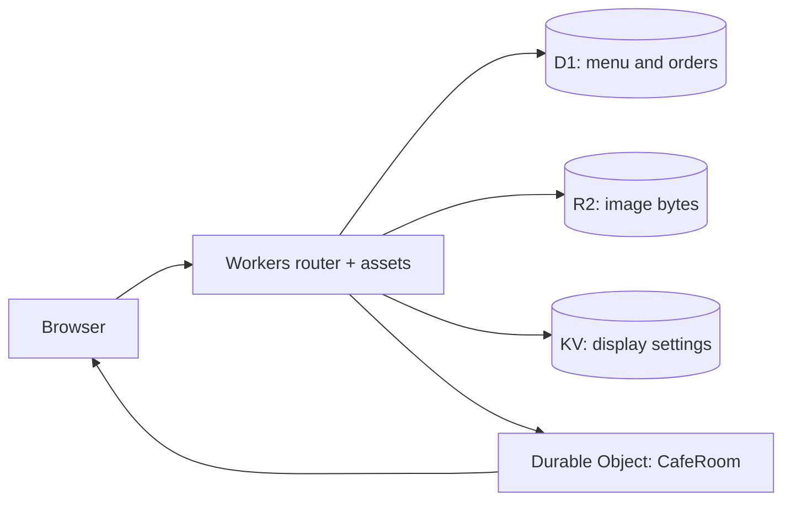
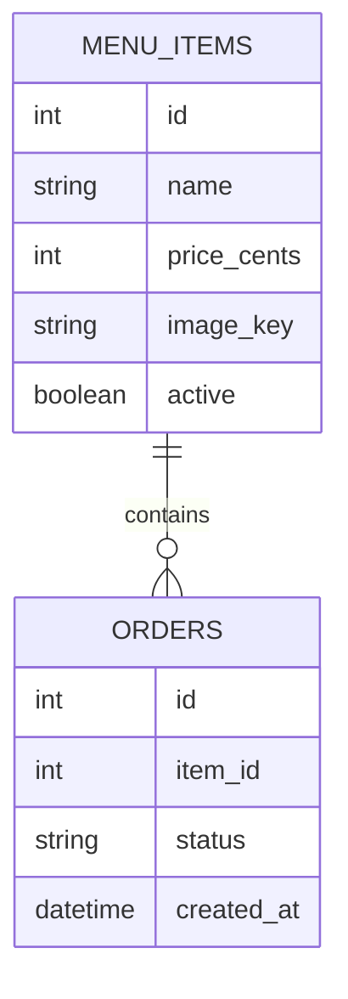
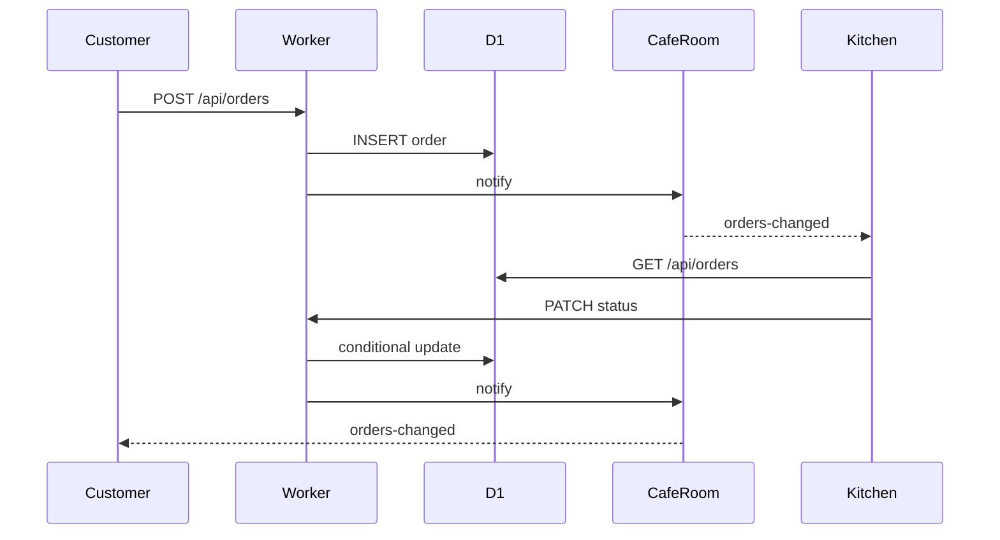

# Architecture

D1 is authoritative for menu and order records. R2 stores binary product images and D1 stores only keys. KV stores the small display document and may be briefly stale. The Durable Object owns connected WebSockets and broadcasts `orders-changed`; clients refetch D1 after receiving it. The stable room name is `main-cafe`.

